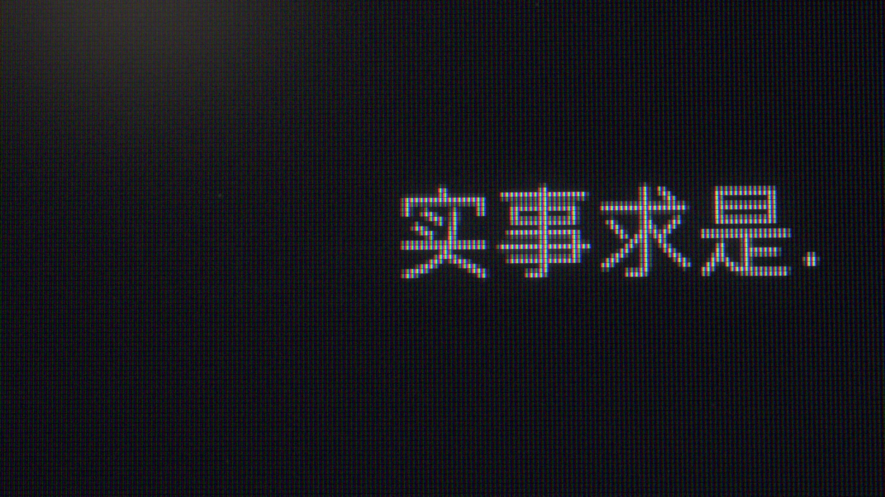

# 实事求是 · Qiushi

[](https://github.com/link1412/anime-02-qiushi/releases/latest)

**[下载成片](https://github.com/link1412/anime-02-qiushi/releases/latest) · 3 分 16 秒 · 1920×1080 · 30 fps**

我问它：世界上最伟大的四个字是什么？不需要理由，直接回答。
它说：实事求是。

有人会不信。我问它怎么证明这是它说的。
它说：用手机对着屏幕录下来。截图可以改，录像难造一些。

所以我录了。

凌晨 00:31，我又问了它一个问题：明天早上吃什么？
然后一直录到天亮。

《实事求是》是一部模拟手机对着电脑屏幕录像的黑色幽默短片。这是动画短片系列的第二部，第一部是[《合焦》](https://github.com/link1412/anime-01-infocus)。

## 画面是怎样做出来的

分镜和相机轨迹写在 `storyboard.json`，影片由八段镜头硬切组成。程序先抓取脚本驱动的 OpenCode 界面，再把它放到虚拟笔记本屏幕上，从虚拟手机相机的位置重新成像。

```text
预先写定的对话 / 工具调用 / 报错
  → OpenCode 网页抓帧 + 输入法 / 菜单栏 / 聚焦与地图合成
  → LCD 的 RGB 子像素、玻璃污渍与房间反射
  → 手持相机、对焦、景深、滚动快门、曝光
  → Bayer 采样、去马赛克、降噪与锐化
  → 编码 + 合成声音 + 配乐
```

这些是按影片需要实现的成像模型和复现选择，不是某款手机内部 ISP 的逐值复刻。浏览器中的 WebGL 分镜工具用于快速预览；最终画面由 Python 离线渲染。

**制作说明：** 所有模型回复、思考、工具调用和报错均为预先写定。“Mythos 10”“Ululululultra”及画面中的模型定价为虚构，没有产生画面中显示的费用。聚焦搜索与地图来自另行录制并裁切合成的 macOS 画面；输入法候选窗、指针和部分界面元素来自系统截图。声音主要由程序合成，打火、吸烟、吐气和清晨鸟叫使用有来源记录的 CC0 录音。配乐由脚本演奏巴赫乐谱，并通过 Keyscape 钢琴音源渲染。完整说明也写入成片元数据。

## 目录

| 路径 | 内容 |
| --- | --- |
| `storyboard.json` | 当前分镜、机位、对焦、时钟、电量及光线变化 |
| `ui/director2.mjs` | 当前版对话剧本、事件编排与界面抓帧 |
| `ui/mock2.mjs`, `ui/mitm.mjs` | 脚本模型服务与本地网页占位代理 |
| `ui/typing.mjs`, `assets/ime/` | 打字编排与真实输入法候选窗素材 |
| `ui/zrec/` | 聚焦搜索 / 地图的录制工具与合成时间映射 |
| `render/` | 屏幕合成、相机、光学与 ISP、音效、混音及编码 |
| `tool/` | 可编辑机位与关键帧的浏览器分镜预览 |
| `music/` | 配乐钉点、MIDI / LilyPond 乐谱与离线钢琴渲染 |
| `assets/sfx/` | 音效素材及逐项来源 |
| `docs/reproduction.md` | 环境、运行步骤与复现边界 |
| `docs/credits.md` | 外部素材、工具及许可说明 |
| `STATE.md` | 原始制作日志；包含旧方案，请按轮次阅读 |

`ui/director.mjs`、`*_v1.*`、探查与试拍脚本属于制作历史；当前入口是 `director2.mjs`。

## 开始使用

需要 Python 3.10+、Node.js、npm。完整制作使用 macOS、Chrome、OpenCode 和带 x264/x265 编码器的 ffmpeg；钢琴渲染另需合法安装的 Spectrasonics Keyscape。

```sh
python3 -m venv venv
venv/bin/python -m pip install -r requirements.txt
npm --prefix ui ci

# 只生成时间轴，不启动浏览器、模型服务或渲染
npm --prefix ui run plan

# 只解析配乐钉点，不加载商业音源
venv/bin/python music/build.py --plan
```

公开仓库保存源码、分镜、输入法与音效素材、乐谱和封面。**完整复现还需要本地桌面素材、界面帧与聚焦 / 地图录屏**，这些文件未随源码发布；当前本地目录也缺少最终 `build/ui_frames/`。因此仅克隆仓库不能直接重新渲染同一份成片。所需文件与生成顺序见[复现说明](docs/reproduction.md)。

成片放在 [GitHub Releases](https://github.com/link1412/anime-02-qiushi/releases)，不放入 Git 历史。缓存、渲染帧、原始桌面截图、浏览器本地状态和商业音源不随本次整理新增发布；既有 24 次源码提交保留。

## 素材与许可

音效逐项来源见 [`assets/sfx/SOURCES.md`](assets/sfx/SOURCES.md)，乐谱及其他素材见[署名说明](docs/credits.md)。音效按其 CC0 声明使用，Mutopia 乐谱保留 CC BY-SA 3.0 署名。商业音源、macOS 和 OpenCode 的素材与界面各有其权利归属。本次整理没有为原创代码和成片新增统一的授权许可证。

## English

*Qiushi* (实事求是, “seek truth from facts”) is a 196-second dark comedy presented as phone recordings of a laptop screen. An AI says the greatest four Chinese characters are “实事求是,” then suggests filming its answer as proof. Later that night, the user asks what to have for breakfast. The recording continues until dawn.

The phone footage is rendered. OpenCode is driven by a scripted local mock server: replies, reasoning, tool calls and errors are written in advance. The fictional model, effort label and displayed prices are part of the story. Spotlight and Maps use separately recorded macOS footage; candidate windows and some interface details use system captures. Sound is synthesised apart from documented CC0 recordings. Bach's Goldberg Variations are performed by script using a separately licensed Keyscape installation.

This repository contains the production source, storyboard and documented assets. Original desktop captures and intermediate screen frames are not bundled, so this is a source archive with documented reproduction steps, not a self-contained render package. See [reproduction notes](docs/reproduction.md), [credits](docs/credits.md) and [film downloads](https://github.com/link1412/anime-02-qiushi/releases/latest).
